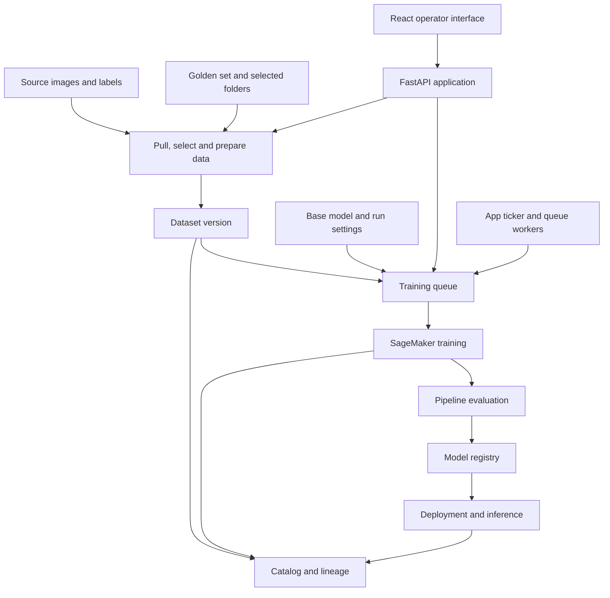

# MLOPS Track 2: How the System Works

Prepared 6 November 2026 from inspection of this repository.

This document explains the system's responsibilities and end-to-end workflow. It describes the checked-out source, not a newly verified AWS deployment. No training jobs, infrastructure changes, live UI checks, or automated tests were run to prepare it.

Related documents: [User guide](documentation.md), [technical documentation](technical_documentation.md), and [PostgreSQL migration record](DATABASE_MIGRATION.md). Deployment statements in those documents are dated evidence, not a current environment check.

## 1. Purpose

Track 2 turns labelled images into versioned YOLO object-detection models. Operators choose the data, classes, starting model, training settings, and schedule. The system prepares datasets, queues training, collects results, and supports model review, inference, and exports.

The central design is traceability: a model should be traceable to its dataset selection, labels, base model, and training settings.

## 2. Architecture

The React frontend and FastAPI API are served by the same application process. The application coordinates AWS resources; SageMaker performs the main training computation. The app also opens and manipulates checkpoints for operations such as base-model registration and class-head selection.

The application is designed around a single web worker, with process-local sessions, caches, and worker state. Durable records complement that local state; adding replicas is not automatically safe merely because a database is present.

Source: [main.py](src/ppe_pipeline_api/main.py), [frontend routes](web/src/App.tsx), [training orchestration](src/ppe_pipeline_api/training/track2_shared.py).

## 3. Data preparation

Data preparation answers: **What will the model learn from?**

The system can pull images and labels from configured sources, organise weekly data, use explicitly selected folders, and include a curated golden set. SQL query tooling also supports finding and pulling selected source records into the data workflow.

Preparation includes:

- Pairing images with labels and inspecting source contents.
- Selecting weeks and folders.
- Establishing training and validation selections.
- Applying retention sampling to older weeks.
- Defining the target class names and class-ID mappings.
- Generating the dataset YAML and file lists.

Retention sampling reduces the contribution of older data; it does not itself delete the source weeks. Explicit purge operations are separate. The golden set supplies curated examples without the weekly decay applied to ordinary historical data.

Different datasets can assign different numeric IDs to the same class. Dataset generation and trainer-side preparation carry class mapping and filtering information so that those IDs can be translated to the intended taxonomy.

Source: [pull control](src/ppe_pipeline_api/pull_control.py), [retention](src/ppe_pipeline_api/data/retention.py), [dataset YAML](src/ppe_pipeline_api/data/dataset_yaml.py), [SQL router](src/ppe_pipeline_api/routers/track2_sql.py).

## 4. Dataset versions and preservation

A queued run must not silently change when somebody edits a preparation card. Dataset versioning captures the selection and its configuration under a dedicated `_datasets/<version_id>/` location.

Version artifacts include training YAML, train/validation lists, evaluation files, and a manifest. They identify the selected files, sources, and classes. Later arrivals in source folders should not become members of an already frozen selection merely because they share a folder.

The central store adds file preservation. It copies images and labels to preserved S3 objects and records the source-to-copy relationship in a preservation manifest and catalog records. Copies can be reused across versions. This supports exports and retraining when original source files are no longer available.

**Selection freezing and file preservation are separate stages.** Preservation runs in the background and has catch-up handling. A version row alone is not proof that every file has already been copied. Older versions may also lack preservation; the preservation module explicitly does not promise recovery of files already lost before that feature existed.

Source: [dataset versions](src/ppe_pipeline_api/data/dataset_versions.py), [central store](src/ppe_pipeline_api/data/central_store.py), [catalog](src/ppe_pipeline_api/data/catalog.py).

## 5. Training configuration and queue

Training answers: **Which model will train, how, and when?**

A run combines a dataset selection/version, detector taxonomy, architecture, starting checkpoint or scratch seed, and hyperparameters such as epochs, image size, batch size, and seed. Queue entries capture these choices so that later UI changes do not redefine existing entries.

The queue advances sequentially, checking current SageMaker activity and submission state before starting another run. Its design reflects limited training capacity. Queue entries are persisted and restored; not all queue-related state exists only in memory.

Stopping queue advancement means no further queued runs should start. Stopping an active training job is a separate operation.

Source: [queue and submission functions](src/ppe_pipeline_api/training/track2_shared.py), [training API](src/ppe_pipeline_api/routers/track2_models.py).

## 6. Two training paths

| Path | Intended taxonomy | Submission mechanism |
|---|---|---|
| Production replay | Fixed `person` and `helmet` classes | CodeBuild and replay coordinator leading to SageMaker |
| Open training | Dataset-defined/custom classes | Direct SageMaker pipeline execution |

The separation protects the production replay path's assumptions about class indices and evaluation. Arbitrary classes cannot simply be treated as the production two-class model.

The current custom submission code defaults to `track2-yolo-open-training-pipeline`, configurable through `OPEN_TRAINING_PIPELINE_NAME`. The older `track2-yolo-custom-training-pipeline` name remains in documentation and code, but is not the default target of the open-training submission function.

For open training, the checked-in pipeline defines training, evaluation, and registration steps. The trainer downloads inputs, builds a temporary filtered dataset, validates it, invokes Ultralytics training, and produces model artifacts. Class translation/filtering applies to the prepared training copy rather than rewriting source labels in S3.

Source: [submission implementation](src/ppe_pipeline_api/training/track2_shared.py), [trainer](model_training/training-container/train.py), [open pipeline](model_training/custom_training/pipeline_open.json), [replay coordinator](model_training/replay_lambda/trigger_weekly_retrain.py).

## 7. Scheduling and background work

The app ticker runs approximately every 25 seconds while enabled. It advances training, reconciles audit records with AWS results, checks pull-to-training chains and training schedules, and performs other maintenance work.

A queue Lambda provides advancement outside the web process. The SQL development backend has additional scheduling and worker-message import logic. Which workers actually execute depends on deployment configuration.

Pull timing and training timing are separate. Training can use existing folders without requiring a fresh pull. Pull completion can also trigger preparation and queueing, subject to the configured mode and guards. Preparing a queue entry and authorising queue advancement are distinct actions.

`APP_BACKGROUND=off` disables the app's startup recovery and queue poll loop. It does not establish that every external AWS schedule is disabled.

Source: [ticker](src/ppe_pipeline_api/chain/ticker.py), [queue Lambda](src/ppe_pipeline_api/chain/queue_runner.py), [SQL worker](src/ppe_pipeline_api/chain/sql_worker.py), [retraining schedule](src/ppe_pipeline_api/chain/retrain_schedule.py).

## 8. Storage responsibilities

| Component | Responsibility |
|---|---|
| S3 | Images, labels, preserved copies, YAML, manifests, checkpoints, and export artifacts |
| DynamoDB operational backend | Queue/settings records, audits, and other operational state in DynamoDB mode |
| PostgreSQL catalog | File provenance, label versions, dataset membership, run relationships, and exports |
| PostgreSQL operational backend | SQL-backed operational records when explicitly selected |
| SageMaker | Training and processing jobs, model packages, endpoints, and inference resources |

`TRACK2_RECORD_BACKEND` defaults to `dynamodb` in source. Setting it to `postgres` selects the SQL adapter, which requires an isolated `track2_dev` or permitted `track2_dev_*` schema and an initialised migration marker. SQL failure is not an instruction to silently fall back to DynamoDB.

The repository's migration record reports a development PostgreSQL cutover on 3 November 2026 while production remained on the original backend. This overview did not re-check that deployed state. The code default must not be mistaken for the development container's actual environment setting.

Source: [record store](src/ppe_pipeline_api/record_store.py), [catalog schema](src/ppe_pipeline_api/data/catalog.py), [migration record](DATABASE_MIGRATION.md).

## 9. Evaluation, registration, deployment, and lineage

Pipeline evaluation produces results associated with the candidate model. The UI exposes metrics and model review operations. Separate evaluation and inference queues support further testing and model use through SageMaker serving resources.

Registration and deployment are different stages: a registered model does not by itself prove that an endpoint is running it. The backend includes endpoint readiness checks, idle cleanup, and startup recovery for interrupted evaluation/inference work.

Approval behavior is path-dependent. The custom-training README describes manual approval, but the checked-in open pipeline specifies `ModelApprovalStatus: Approved`. Therefore, a mandatory human approval gate cannot be assumed for every training path. The deployed pipeline definition would need inspection to establish live behavior.

Audit and lineage records connect runs to their data, configuration, model artifacts, and inference outputs. The catalog makes those relationships searchable rather than leaving them only in S3 paths or job logs.

Source: [review API](src/ppe_pipeline_api/routers/track2_review.py), [deploy API](src/ppe_pipeline_api/routers/track2_deploy.py), [evaluation API](src/ppe_pipeline_api/routers/track2_eval.py), [open pipeline](model_training/custom_training/pipeline_open.json).

## 10. Repository map

| Location | Main responsibility |
|---|---|
| `web/src/` | Operator pages, shared UI components, and API calls |
| `src/ppe_pipeline_api/routers/` | HTTP endpoints and request validation |
| `src/ppe_pipeline_api/data/` | Preparation, versions, catalog, and preservation |
| `src/ppe_pipeline_api/training/` | Training, registry, inference, evaluation, and run artifacts |
| `src/ppe_pipeline_api/chain/` | Scheduling and workflow orchestration |
| `model_training/` | Training containers, evaluators, and pipeline assets |
| `terraform/app/` | Application-owned infrastructure |
| `terraform/platform/` | Shared platform infrastructure |
| `tests/` | Regression tests for API, data, scheduling, and training behavior |

Several top-level Python modules are compatibility aliases to the reorganised `data/`, `training/`, and `chain/` implementations. Follow those aliases before deciding where the actual logic lives.

## 11. Reading and verification boundaries

This is an architecture explanation, not an end-to-end certification. Source inspection does not establish the deployed container version, Lambda package, trainer image digest, current database backend, schedule state, or endpoint state.

Known documentation differences to keep in mind:

- Older descriptions naming the custom pipeline may refer to its superseded predecessor.
- Manual approval is not universal in the checked-in pipeline definitions.
- Older references to in-memory queues omit persisted queue entries and external queue workers.
- The DynamoDB source default does not negate the recorded development PostgreSQL cutover.

When updating this overview, verify behavior in implementation first, then distinguish that behavior from dated deployment evidence and fresh live checks.

## 12. Retention and golden-set safeguards (6 November 2026)

The retention policy still uses **non-empty collection age**, not calendar time. It selects image paths rather than changing training loss weights. Existing rates, floors, and full-collection windows keep their meaning.

The Retention card now reports the actual recent, historical, and golden training contributions. These counts cover weekly sources and golden training images; other picked folders are explicitly outside this report. An old, large collection can still dominate a smaller recent one after decay.

Use **Check label coverage** to inspect labels on demand. It reports per-source class IDs before remapping, counts of images containing each class before/after selection, classes lost through selection, and missing, unreadable, invalid, or explicit empty labels. The warning threshold is saved as `retention.min_class_images` (default 5). It is a warning threshold, not an automatic exemption from sampling. Inspection does not establish scene independence, content deduplication, final detector-filter coverage, or model quality.

Golden-set builds now pair by relative path and preserve nested destinations. Ambiguous image extensions or label identities are rejected instead of overwritten. The first build freezes validation membership in `split.json`; later additions go to training. Removing or changing validation objects is blocked, and changing the split settings or source requires a new target folder. Thus the requested training percentage applies to the initial split; subsequent source growth can change the actual ratio.

Existing manifests retain their assignments on upgrade. Legacy manifests have no content signatures: the first successful upgraded build establishes those signatures and cannot retrospectively prove that older files were unchanged. S3 ETags are used as object-change validators, not cryptographic proof of image uniqueness.

Each successful split revision is recorded under `split-versions/`, with a benchmark ID. Initial assignments are reserved before copying so failed first builds retry the same membership. Copy/cleanup/manifest failures stop the build. A conditional S3 lock prevents concurrent writers to a target. If a process crashes and leaves `.split-build-lock.json`, verify that no writer is running before removing that exact lock and retrying; there is deliberately no automatic expiry that could race a slow writer. The copied target itself is not an atomic multi-object transaction.

New dataset versions carry a `validation_selection_id`, displayed in the Dataset versions card. It identifies the validation paths, taxonomy, and remapping. Matching IDs do not prove unchanged bytes or an independent test set. Keep a separately curated, fixed test benchmark outside checkpoint selection when comparing candidate models; this change does not add a new SageMaker test stage or automatically promote models.

Regression coverage includes source growth, validation-object changes, nested filename collisions, first-build retries, concurrent-writer rejection, class loss, contribution imbalance, and selection-ID changes. Deployment and test outcomes are recorded in the implementation handover rather than inferred from this architecture description.
